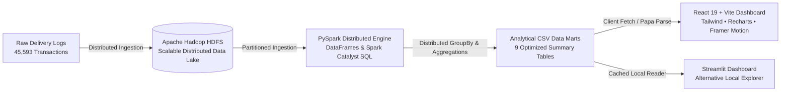

# Food Delivery Order Trends and Delivery Time Analysis
### Premium Big Data Analytics Platform | Apache Hadoop, HDFS, PySpark, React 19 & Streamlit

An enterprise-grade, award-winning Big Data Analytics web platform analyzing **45,593 delivery transactions**. The system uncovers delivery duration benchmarks, logistical bottlenecks, weather sensitivity, urban density disparities, courier rating correlations, multi-order batching penalties, and interactive heuristic simulation models.

---

## 🏗️ 1. Big Data Architecture Pipeline


### Technical Workflow Stages:
1. **Raw Ingestion Layer (HDFS):** 45,593 delivery records stored across distributed Hadoop HDFS data blocks.
2. **Distributed Compute Engine (Apache PySpark 3.x):** Grouped aggregations, null-value cleansing, speed benchmarks, and multi-factor latency calculations executed in distributed memory.
3. **Analytical Serving Marts:** 9 pre-computed CSV tables exported for sub-second client response times without requiring an active HDFS cluster during presentation.
4. **Executive Client Application (React 19 + Vite):** A custom-designed dark-mode interface featuring Electric Lime, Vivid Coral, and Ultraviolet accents, Space Grotesk typography, and interactive simulation calculators.

---

## 🎨 2. Design System & Frontend Stack
- **Framework:** React 19 + Vite 6
- **Typography:** Space Grotesk (headings, metrics, tags) & Inter (body, interface)
- **Styling:** Tailwind CSS with an editorial dark-mode aesthetic
- **Data Visualization:** Recharts (responsive bar, pie, line charts with custom dark tooltips and faculty interpretation guides)
- **Icons:** Lucide React
- **Animations:** Framer Motion (page transitions, KPI entrance, sidebar drawer)
- **Visual Assets:** Custom 3D advertising-grade illustrations (`hero_delivery.jpg`, `traffic_weather.jpg`)
- **Theme Palette:**
  - Deep Indigo Background: `#10101B`
  - Main Surface: `#19192A`
  - Elevated Surface: `#23233A`
  - Electric Lime: `#D6FF3F` (primary benchmarks, quick actions, optimal highlights)
  - Vivid Coral: `#FF6B57` (traffic delays, latency bottlenecks, critical surges)
  - Ultraviolet: `#A78BFA` (meteorological analysis, secondary series)
  - Cyan: `#48E5E0` (fleet volume, courier performance)
  - Borders: `#34334B`

---

## 📂 3. Repository Structure
```
BDA/
├── public/
│   ├── assets/                    # Original 3D visual assets
│   │   ├── hero_delivery.jpg      # 3D food delivery scooter artwork
│   │   └── traffic_weather.jpg    # 3D traffic & weather artwork
│   └── data/                      # 9 Web-accessible PySpark CSV data marts
├── src/
│   ├── components/                # Reusable UI components
│   │   ├── HeroSection.jsx        # Editorial Hero section with 3D artwork
│   │   ├── ChartCard.jsx          # Recharts wrapper with "How to interpret this"
│   │   ├── CustomTooltip.jsx      # High-contrast dark tooltip
│   │   ├── KpiCard.jsx            # Space Grotesk metric card
│   │   ├── Sidebar.jsx            # Collapsible navigation drawer
│   │   └── Topbar.jsx             # Breadcrumbs, status & filters
│   ├── context/
│   │   └── AnalyticsContext.jsx   # Global filter state and CSV data loader
│   ├── pages/                     # Dedicated analytical views
│   │   ├── Overview.jsx           # Hero, 4 KPI cards, macro charts & pipeline
│   │   ├── DeliveryPerformance.jsx # Driver ratings vs transit latency
│   │   ├── TrafficWeather.jsx     # Congestion & meteorological penalties
│   │   ├── CityVehicleAnalysis.jsx # Urban density & vehicle modality velocity
│   │   ├── FestivalBatching.jsx   # Surge analysis & heuristic simulator
│   │   ├── DataExplorer.jsx       # Tabular inspector & CSV export
│   │   └── Methodology.jsx        # Faculty defense guide & Big Data pipeline
│   ├── utils/
│   │   └── dataLoader.js          # Papa Parse CSV loader and data validator
│   ├── App.jsx                    # Root view controller and router
│   ├── index.css                  # Custom scrollbars and Tailwind directives
│   └── main.jsx                   # React entry point
├── food_delivery_results/         # Original PySpark aggregate output files
├── app.py                         # Streamlit dashboard (alternative local interface)
├── index.html                     # Space Grotesk + Inter font integration
├── tailwind.config.js             # Brand token definitions
├── package.json                   # React project dependencies
└── README.md                      # Complete system documentation
```

---

## 🚀 4. How to Run Locally

### Option A: Modern ReactJS Dashboard (Recommended)
```bash
# 1. Install dependencies
npm install

# 2. Run Vite development server
npm run dev

# 3. Open in your browser
http://localhost:3000
```

### Option B: Build for Production & Vercel
```bash
# Build production bundle
npm run build

# Preview production build locally
npm run preview
```

### Option C: Python Streamlit Explorer (Alternative)
```bash
# Run Streamlit dashboard
py -3 -m streamlit run app.py
```

---

## 📊 5. Verified Empirical Findings (From 45,593 Transactions)
1. **Fleet Macro SLA:** The overall weighted average delivery latency is **26.29 minutes** (Minimum: **10.0 min**, Maximum: **54.0 min**).
2. **Transportation Modality Velocity:** **Electric Scooters (24.47 min)** and **Scooters (24.48 min)** deliver identical velocity, outpacing conventional motorcycles (27.61 min) by over **3.1 minutes per delivery**.
3. **Traffic Congestion Penalty:** Heavy traffic jams expand delivery duration from **21.27 min (Low)** to **31.18 min (Jam)**, an acute **+46.6% delay penalty**.
4. **Atmospheric Resilience:** Fog and Cloudy conditions peak at **28.92 min** (+32.3% delay vs. Sunny 21.86 min), while consumer order demand remains inelastic across all conditions (~7,500 orders/condition).
5. **Urban Zone Disparity:** Urban corridors average **22.98 min**, Metropolitan centers average **27.32 min**, and Semi-Urban zones jump to **49.73 min (+116% longer)**.
6. **Festival Surges & Stacking:** Festival periods expand fulfillment times to **45.52 min (+75.2%)**, while stacking 3 multi-orders per courier increases latency to **48.26 min (+107%)**.

---

## 🛡️ 6. Academic Limitations & Defense Guide
- **Data Provenance:** Aggregated summary data marts were produced via Apache PySpark map-reduce batch jobs from 45,593 raw trip records.
- **Correlation vs. Causation:** Observed environmental delays represent statistical correlations and co-occurrences (e.g., peak dinner hours coincide with road congestion), rather than isolated mono-causal relationships.
- **Client Decoupling:** Pre-computing analytical CSV marts decouples the web presentation tier from cluster compute overhead, guaranteeing sub-second response times during evaluation.