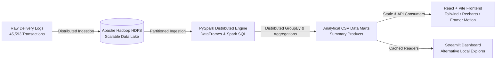

# Food Delivery Order Trends and Delivery Time Analysis
### Big Data Analytics Platform | Apache Hadoop, HDFS, PySpark, React & Streamlit

An enterprise-grade Big Data Analytics web platform analyzing **45,593 delivery transactions**. The system uncovers delivery duration benchmarks, logistical bottlenecks, weather sensitivity, urban density disparities, courier rating correlations, and multi-order batching penalties.

---

## 🏗️ 1. Big Data Architecture


---

## 🎨 2. Frontend Tech Stack (React + Vite)
- **Framework:** React 18 + Vite 6
- **Styling:** Tailwind CSS with custom midnight navy & cyan design system
- **Data Visualization:** Recharts (responsive bar, pie, line charts with custom dark tooltips)
- **Icons:** Lucide React
- **Animations:** Framer Motion (subtle entrance and interaction transitions)
- **CSV Parsing:** Papa Parse (static asset loading from `/data/*.csv`)
- **Theme Palette:**
  - Background: `#0B1020`
  - Sidebar: `#0E1528`
  - Surface Cards: `#141D32`
  - Primary Accent: Electric Cyan `#38D9F8`
  - Secondary Accent: Violet `#8B7CFF`
  - Success Indicator: Emerald `#34D399`
  - Warning/Danger: Amber `#FBBF24` / Rose `#FB7185`

---

## 📂 3. Repository Structure
```
BDA/
├── public/
│   └── data/                      # Web-accessible CSV data marts (9 files)
├── src/
│   ├── components/                # Reusable UI components
│   │   ├── ChartCard.jsx          # Standardized Recharts wrapper
│   │   ├── CustomTooltip.jsx      # High-contrast dark tooltip
│   │   ├── KpiCard.jsx            # Animated metric indicator
│   │   ├── Sidebar.jsx            # Collapsible navigation drawer
│   │   └── Topbar.jsx             # Breadcrumbs, status & global filters
│   ├── context/
│   │   └── AnalyticsContext.jsx   # Global filter state and CSV data loader
│   ├── pages/                     # Dedicated analytical views
│   │   ├── Overview.jsx           # Executive summary & macro benchmarks
│   │   ├── DeliveryPerformance.jsx # Driver ratings vs transit latency
│   │   ├── TrafficWeather.jsx     # Congestion & meteorological penalties
│   │   ├── CityAnalysis.jsx       # Urban density zone latency comparison
│   │   ├── VehicleAnalysis.jsx    # Transportation modality velocity
│   │   ├── FestivalBatching.jsx   # Surge analysis & heuristic simulator
│   │   └── DataExplorer.jsx       # Tabular inspector & CSV export
│   ├── utils/
│   │   └── dataLoader.js          # Dynamic CSV fetcher & fallback loader
│   ├── App.jsx                    # Root application structure
│   ├── index.css                  # Tailwind styles and custom scrollbars
│   └── main.jsx                   # React mounting entrypoint
├── food_delivery_results/         # Original PySpark aggregated CSV results
├── Food-Delivery-Analysis/        # Original CSV result directory (preserved)
├── app.py                         # Streamlit dashboard implementation
├── requirements.txt               # Python dependencies for Streamlit
├── package.json                   # Node.js project manifest & dependencies
├── tailwind.config.js             # Tailwind configuration
├── vite.config.js                 # Vite build configuration
└── README.md                      # Platform documentation & setup guide
```

---

## 🚀 4. How to Run Locally

### Option A: React + Vite Dashboard (Recommended)
1. **Ensure Node.js (v18+) is installed.**
2. **Install dependencies:**
   ```bash
   npm install
   ```
3. **Start the local Vite development server:**
   ```bash
   npm run dev
   ```
4. **Access the application:**
   Open [http://localhost:3000](http://localhost:3000) in your browser.

### Option B: Streamlit Dashboard (Alternative)
1. **Ensure Python 3 is installed.**
2. **Install Python requirements:**
   ```powershell
   py -3 -m pip install -r requirements.txt
   ```
3. **Launch Streamlit:**
   ```powershell
   py -3 -m streamlit run app.py
   ```
4. **Access Streamlit:**
   Open [http://localhost:8501](http://localhost:8501) in your browser.

---

## 🌐 5. Deployment Guide: Vercel

The React application is pre-configured for zero-configuration Vercel deployment:

### Method 1: Deploy via Vercel Dashboard
1. Push your repository to GitHub:
   ```bash
   git add .
   git commit -m "feat: complete React analytics dashboard"
   git push origin main
   ```
2. Log into [vercel.com](https://vercel.com).
3. Click **Add New...** ➔ **Project**.
4. Import your GitHub repository (`SmartDeliveryApp`).
5. Select **Vite** as the Framework Preset (defaults are automatically detected):
   - **Build Command:** `npm run build`
   - **Output Directory:** `dist`
   - **Install Command:** `npm install`
6. Click **Deploy!**

### Method 2: Deploy via Vercel CLI
```bash
npm install -g vercel
vercel
```

---

## 📊 6. Key Empirical Findings (From 45,593 Orders)

- **Dataset Scale:** 45,593 delivery transactions with a fleet benchmark average of **26.29 minutes** (ranging from **10.0m** to a peak threshold of **54.0m**).
- **Vehicle Modality:** Electric Scooters (**24.47 min**) and Scooters (**24.48 min**) deliver **3.14 minutes faster** than conventional motorcycles (**27.61 min**).
- **Traffic Congestion:** Traffic jams extend delivery latency to **31.18 minutes** (**+46.6% delay** over low-traffic conditions at 21.27 min).
- **Atmospheric Impact:** Cloudy and Foggy conditions introduce significant visual and road friction (**28.92 min**, a **+32.3% delay** over clear Sunny days at 21.86 min).
- **Spatial Geometry:** Semi-urban deliveries average **49.73 minutes** due to extended transit radiuses, more than double urban centers (**22.98 min**).
- **Festival Season:** Delays surge by **+75.2%** during festival events (**45.52 min** vs 25.98 min benchmark).
- **Batching Delays:** Stacking multiple orders per courier sharply degrades transit times: 0 stacked = 22.88m, 1 stacked = 26.86m, 2 stacked = 40.45m, 3 stacked = 47.82m.